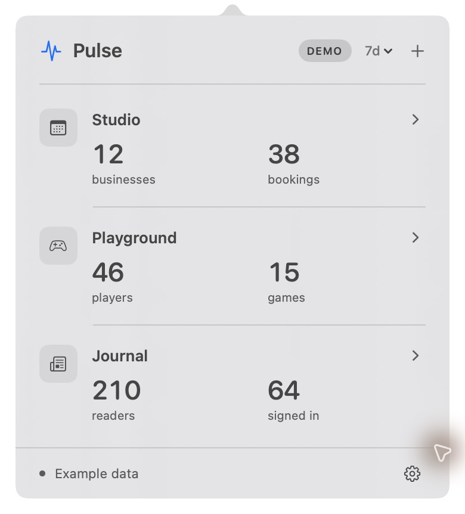

# Pulse

Your project numbers, in the Mac menu bar.

A small native app for accounts, bookings, players, readers, or anything else your sources measure. Connect an API, PostgreSQL, or Supabase. Pick the numbers you care about and leave Pulse running.

## Install

A signed Mac download is being prepared. For now, [build from source](docs/development.md).

macOS 14 or later · Apple silicon and Intel

## Get started

1. Open Pulse from Applications.
2. Click **+**, paste your connection details, and add its credential.
3. Choose your metrics and click **Add Project**.

Use the range menu for **24h · 7d · 30d · Lifetime**. Click **ⓘ** to choose headline KPIs, drawer numbers and breakdowns, or the arrow to expand them. Click a project’s name to open the source, or its icon to change it.

Optional native alerts report new activity. Use **Test alert** in Settings to check them.

For desktop widgets, right-click the desktop → **Edit Widgets → Pulse**. Choose **Project** or **Overview**; right-click a widget to choose its project and time range. Keep Pulse running for fresh numbers. macOS controls widget refresh timing.

## Your data stays yours

Pulse runs on your Mac. Credentials stay in Keychain; settings and cached numbers stay in Application Support. Connections are read-only. There is no Pulse account or hosted service.

Refreshes run every five minutes while Pulse is open and your Mac is awake. Available history depends on the connected source.

[Connection guide](docs/connections.md) · [Build and contribute](docs/development.md) · [MIT license](LICENSE)
